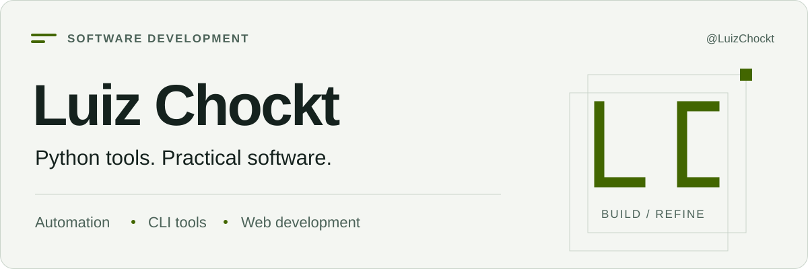

<picture>
  <source media="(prefers-color-scheme: dark) and (max-width: 600px)" srcset="./assets/banner-mobile-dark.svg">
  <source media="(max-width: 600px)" srcset="./assets/banner-mobile-light.svg">
  <source media="(prefers-color-scheme: dark)" srcset="./assets/banner-dark.svg">
  <source media="(prefers-color-scheme: light)" srcset="./assets/banner-light.svg">
  
</picture>

[English](./README.md) · [Projetos](#projetos-em-destaque) · [Repositórios](https://github.com/LuizChockt?tab=repositories)

# Olá, sou o Luiz.

Desenvolvo **ferramentas Python para Markdown, organização de arquivos e automação**, além de projetos web com **JavaScript, HTML e CSS**.

Sou formado em Análise e Desenvolvimento de Sistemas e moro no Brasil. Minha formação e experiência em Direito trazem problemas práticos para resolver com software: documentos, informações e trabalho repetitivo.

## Projetos em destaque

### [Markdown Link Auditor](https://github.com/LuizChockt/markdown-link-auditor)

Localiza referências locais quebradas, anexos ausentes, links ambíguos e possíveis notas órfãs em bases Markdown. Aceita CommonMark e wikilinks do Obsidian, com relatórios determinísticos em texto e JSON.

**Python · markdown-it-py · pytest · GitHub Actions**

Leitura sem alterar notas, resolução com tratamento de Unicode e limites explícitos de acesso ao sistema de arquivos. URLs externas são contadas, sem consulta HTTP.

[Código e início rápido](https://github.com/LuizChockt/markdown-link-auditor#quick-start) · [Relatório de exemplo](https://github.com/LuizChockt/markdown-link-auditor/blob/main/examples/reports/sample-report.txt) · [CI](https://github.com/LuizChockt/markdown-link-auditor/actions/workflows/tests.yml)

### [Legal Markdown Organizer](https://github.com/LuizChockt/legal-markdown-organizer)

Organiza arquivos jurídicos Markdown por regras de nomes e um subconjunto de metadados front matter. Permite conferir os movimentos com dry-run, preserva os bytes dos documentos e evita sobrescrever destinos existentes.

**Biblioteca padrão Python · pytest · GitHub Actions**

Uma CLI local que aproxima rotinas documentais jurídicas e automação prática. A classificação é determinística; a ferramenta não interpreta argumentos jurídicos nem reescreve links.

[Código e início rápido](https://github.com/LuizChockt/legal-markdown-organizer#quick-start) · [Exemplos fictícios](https://github.com/LuizChockt/legal-markdown-organizer/tree/main/examples) · [CI](https://github.com/LuizChockt/legal-markdown-organizer/actions/workflows/tests.yml)

### Projetos web

Projetos anteriores de aprendizagem, evoluídos com interfaces responsivas, separação da lógica e testes com Node.js.

- **[Calculadora JavaScript](https://github.com/LuizChockt/CalculadoraAprendizadoJS)** — parser aritmético, entrada por teclado e histórico da sessão. [Demonstração](https://luizchockt.github.io/CalculadoraAprendizadoJS/).
- **[Calculadora de Média Escolar](https://github.com/LuizChockt/Media-Escolar-Calc)** — médias ponderadas, validação de entradas e critérios configuráveis. [Demonstração](https://luizchockt.github.io/Media-Escolar-Calc/).

## Ferramentas que utilizo

**Python · JavaScript · HTML · CSS · Git · Markdown**

**pytest** nos testes de comportamento em Python, **executor de testes do Node.js** na lógica web e **GitHub Actions** para integração contínua.

## Como desenvolvo

- Separo interpretação, regras e operações em arquivos para testar cada parte.
- Verifico CLIs reais, casos de borda e comportamento do sistema de arquivos com dados fictícios.
- Documento comandos executáveis, escopo e limitações junto ao código.
- Mantenho o processamento de documentos local e as dependências proporcionais ao problema.

Meu foco atual é automação prática, ferramentas CLI e interfaces web claras.

[Explorar repositórios](https://github.com/LuizChockt?tab=repositories) · [Manutenção do perfil](./docs/MAINTENANCE.md)
